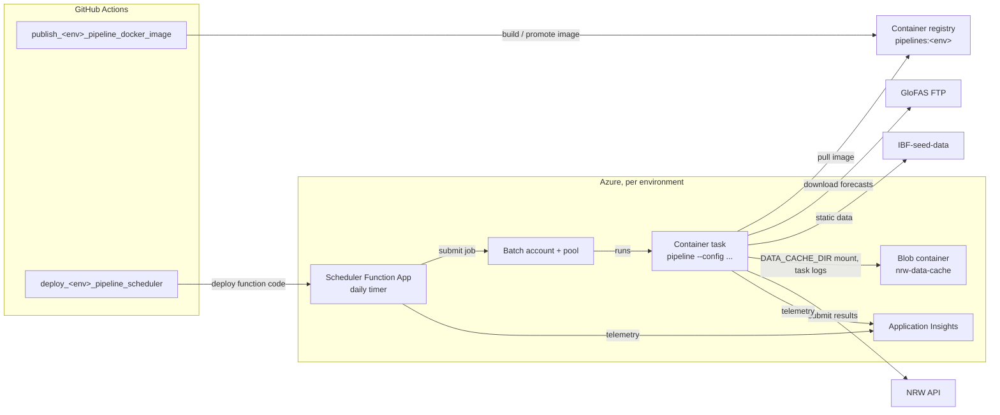

# Pipeline deployment

How the forecast pipelines run in Azure: what triggers them, what runs where, and how code gets deployed.

- To run, monitor or debug deployed pipeline jobs, see [operations.md](operations.md).
- To run pipelines locally, see the [pipelines README](../README.md).
- The Azure resources are defined as Bicep in the (private) `NRW-infra` repository. Its README describes the resources, their permissions and how to deploy them.

## Overview

Every day, the scheduler Function App of each environment submits one Azure Batch job per hazard. Each job runs a single container task with the pipeline Docker image. The task loads its input data, runs the forecast per country and submits the results to the NRW API of the same environment.

## Entry points

| Entry point                   | Where                                                                                                                                                                                     | Trigger                                                                          |
| ----------------------------- | ----------------------------------------------------------------------------------------------------------------------------------------------------------------------------------------- | -------------------------------------------------------------------------------- |
| Scheduled run                 | `daily_pipeline_scheduler` in [function/function_app.py](function/function_app.py) (production only)                                                                                      | Daily at 12:00 UTC; one job per hazard in `SCHEDULED_HAZARD_TYPES` (now: floods) |
| Manual run                    | `manual_pipeline_scheduler` route in [function/function_app.py](function/function_app.py) (test and staging only), called by [function/run_pipeline_job.sh](function/run_pipeline_job.sh) | By hand, see [operations.md](operations.md#manually-starting-a-job)              |
| Publish pipeline image        | `.github/workflows/publish_<env>_pipeline_docker_image.yml` → [build-and-push-image.sh](build-and-push-image.sh)                                                                          | See [CI/CD](#cicd)                                                               |
| Deploy scheduler Function App | `.github/workflows/deploy_<env>_pipeline_scheduler.yml`                                                                                                                                   | See [CI/CD](#cicd)                                                               |

## Files in this folder

| File                                                                                             | Purpose                                                                                                                |
| ------------------------------------------------------------------------------------------------ | ---------------------------------------------------------------------------------------------------------------------- |
| [Dockerfile](Dockerfile)                                                                         | Image run by the Batch tasks. Build context is `data/`. YAML configs are baked in, so config changes need a new image. |
| [build-and-push-image.sh](build-and-push-image.sh)                                               | Builds and pushes the image (`test`, `staging`) or promotes `staging` to `production`. Used by the publish workflows.  |
| [function/function_app.py](function/function_app.py)                                             | Timer trigger (production) or Entra-protected HTTP route (test, staging) of the scheduler Function App.                |
| [function/batch_client.py](function/batch_client.py)                                             | Builds and submits the Batch job and container task. Shared by scheduled and manual runs, so both behave the same.     |
| [function/pipeline_run_request.py](function/pipeline_run_request.py)                             | Validates the optional JSON body of the manual run route.                                                              |
| [function/run_pipeline_job.sh](function/run_pipeline_job.sh)                                     | Starts a manual run on test or staging through the HTTP route.                                                         |
| [function/requirements.txt](function/requirements.txt), [function/host.json](function/host.json) | Function App packaging.                                                                                                |

## Environments

|                                              | test                                | staging                                | production                          |
| -------------------------------------------- | ----------------------------------- | -------------------------------------- | ----------------------------------- |
| Scheduler Function App                       | `nrw-batch-scheduler-test`          | `nrw-batch-scheduler-staging`          | `nrw-batch-scheduler-prod`          |
| `IBF_ENVIRONMENT`                            | `test`                              | `staging`                              | `production`                        |
| Image                                        | `pipelines:test`                    | `pipelines:staging`                    | `pipelines:production`              |
| Batch account / pool                         | `nrwbatchtest` / `nrwbatchtestpool` | `nrwbatchtest` / `nrwbatchstagingpool` | `nrwbatchprod` / `nrwbatchprodpool` |
| Storage account (container `nrw-data-cache`) | `nrwbatchtest`                      | `nrwbatchstaging`                      | `nrwbatchprod`                      |
| Application Insights                         | `nrw-batch-scheduler-test`          | `nrw-batch-scheduler-staging`          | `nrw-batch-scheduler-prod`          |
| Environment name for the manual run scripts  | `test`                              | `staging`                              | N/A                                 |

Test and staging share their Batch, storage, Key Vault and Application Insights resources. They differ only in their scheduler Function App, whose settings (environment, API URL, API key) are passed on to the job, and in the image tag.

## How a job runs

- The scheduler Function App submits a job named `nrw-<hazard>-<yyyymmdd-HHMMSS>` with a single task running `pipeline --config pipelines/infra/configs/<hazard>.yaml` in the image `pipelines:<IBF_ENVIRONMENT>`.
- The task gets its environment variables from the Function App settings (`TASK_ENVIRONMENT_VARIABLES` in [batch_client.py](function/batch_client.py)). Secrets are Key Vault references in those settings; other settings are plain values. All these values, including secrets, are readable by anyone with access to the Batch account.
- The pipeline only talks to the NRW API; it has no direct database access.
- The pool scales up from 0 nodes when a task is queued (max 2 nodes) and pre-pulls the image, so tasks start quickly.
- `DATA_CACHE_DIR` is a blobfuse mount of the `nrw-data-cache` blob container, so downloads and intermediate files are kept between runs.
- A failed task is not retried by Batch. Retries happen inside the pipeline, e.g. for downloads and for countries that failed to load their data.
- A task is stopped after 10 hours.
- On completion, the task's `stdout.txt` and `stderr.txt` are uploaded to `nrw-data-cache/task-logs/<hazard>/<job-id>/`.

### Blob storage retention

The pipeline writes to these prefixes under `DATA_CACHE_DIR` (see `pipelines/infra/utils/storage_helpers.py`). Retention is set by lifecycle rules on the storage account in `NRW-infra`.

| Prefix                                        | Content                                  | Retention |
| --------------------------------------------- | ---------------------------------------- | --------- |
| `glofas/raw/{forecast_date}/`                 | Global GloFAS downloads                  | 30 days   |
| `glofas/country_split/{forecast_date}/`       | Country-split GloFAS data                | No limit  |
| `glofas/country_split_alert/{forecast_date}/` | Country-split data that triggered alerts | No limit  |
| `glofas/country_mock_data/{country}/`         | Mock GloFAS data for `--mock` runs       | No limit  |
| `task-logs/{hazard_type}/{job_id}/`           | Batch task stdout/stderr                 | 90 days   |

A daily set of global GloFAS downloads is about 50 files of about 600 MB each (about 30 GB). The pipeline loads one file at a time, so it needs about 0.6–1 GB of working memory for them.

## CI/CD

| Workflow                                  | test                                                           | staging                               | production                                           |
| ----------------------------------------- | -------------------------------------------------------------- | ------------------------------------- | ---------------------------------------------------- |
| `publish_<env>_pipeline_docker_image.yml` | Builds `pipelines:test` on push to `main` touching `data/**`   | Builds `pipelines:staging` on release | Copies `pipelines:staging` to `pipelines:production` |
| `deploy_<env>_pipeline_scheduler.yml`     | On push to `main` touching `data/pipelines/deploy/function/**` | On release                            | Manually                                             |

Staging and production are deployed through `deploy_staging_all.yml` (on release) and `deploy_prod_all.yml` (manually), together with the api-service. All workflows can also be started manually.

Production does not build a new image, but copies whatever `pipelines:staging` holds at that moment. Normally that is the last release, but a manual run of the staging publish workflow overwrites it. So only deploy to production right after the release you want has been deployed to staging.

## Logging and alerts

- Pipeline logs go to the environment's Application Insights component with role name `nrw-pipeline`. Each log message starts with a tag (`tag_<name>`, see `LogTag` in `pipelines/infra/utils/nrw_logger.py`) and a live-or-mock marker (`data_live` / `data_mock`). The run origin (`scheduled`, `manual`, `local`) is in `customDimensions.run_origin`.
- The Application Insights components are backed by the shared `nrw-app-law` Log Analytics workspace, so pipeline and backend logs can be queried together.
- A metric alert on each Batch account emails the team when a task fails.

See [operations.md](operations.md) for how to use these.
